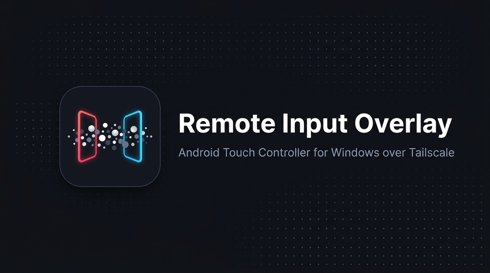
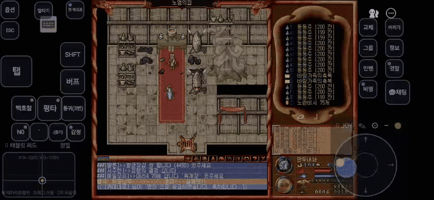
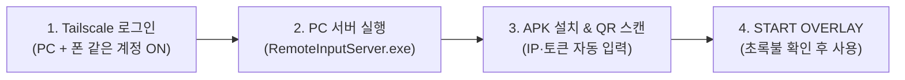

# Remote Input Overlay

Android 스마트폰에서 원격 화면(Parsec 등) 위에 투명 터치 컨트롤러를 띄워, **Windows PC로 키보드·마우스 입력을 전달**하는 무료 도구입니다.

---

## 🎬 실제 동작 미리보기

> [▶ 전체 고화질 시연 영상 보기 (4분 28초 · MP4)](https://github.com/rech4210/remote-input-overlay/releases/download/v1.4.3/demo.mp4)

---

## ✅ 3분 설치 가이드

### 📦 설치 대상 한눈에 보기

| 기기 | 설치할 프로그램 | 다운로드 |
|:---:|:---|:---|
| **PC** Windows 10/11 (64비트) | **Tailscale** *(PC·폰 무료 연결 앱)* | [PC용 Tailscale 설치](https://tailscale.com/download/windows) |
| **PC** Python 별도 설치 불필요 | **RemoteInputServer.exe** *(입력 수신 서버)* | [EXE 바로 받기](https://github.com/rech4210/remote-input-overlay/releases/latest/download/RemoteInputServer.exe) |
| **스마트폰** Android 8.0 이상 | **Tailscale** *(PC·폰 무료 연결 앱)* | [Google Play 스토어](https://play.google.com/store/apps/details?id=com.tailscale.ipn) |
| **스마트폰** iOS 미지원 | **Remote Input Overlay** *(터치 오버레이 앱)* | [APK 바로 받기](https://github.com/rech4210/remote-input-overlay/releases/latest/download/RemoteInputOverlay-latest.apk) |

<table>
  <tr>
    <td align="center" width="180">
       
      <b>📱 폰 카메라로 APK 받기</b>
    </td>
    <td>
      <b>원클릭 빠른 다운로드</b>  
       
       
      
    </td>
  </tr>
</table>

### 1단계 · Tailscale 연결 (PC + 폰)
- [ ] PC와 스마트폰에 **Tailscale** 설치 → **같은 계정**(구글·애플 등)으로 로그인 후 스위치 **ON**
  - *폰에서 처음 켤 때 뜨는 **VPN 연결 요청 팝업**은 **`허용`**을 눌러주세요.*

### 2단계 · Windows PC 서버 실행
- [ ] **`RemoteInputServer.exe`** 더블클릭 → 관리자 권한 팝업 **`예`** 클릭 → 검은 창에 **QR 코드** 표시 확인
  - *"PC 보호"* 파란 창이 뜨면 **`추가 정보 → 실행`** *(Tailscale 전용 방화벽 규칙은 자동 등록됩니다)*

### 3단계 · 스마트폰 연결 & 실행
- [ ] 위 **QR 코드 스캔**(또는 APK 버튼)으로 앱 설치 → **`GRANT OVERLAY PERMISSION`** 허용
- [ ] **`📷 QR 코드로 1초 연결`** 클릭 → PC 화면의 QR 코드 스캔 *(IP·포트·토큰 자동 입력)*
- [ ] **`START OVERLAY`** 클릭 → 상단 상태 점이 **초록색(`●`)**이면 완료 *(Parsec 등 원격 앱을 가로모드로 켜고 바로 사용)*

---

## 🎮 조작 및 주요 기능

| 아이콘 | 기능 |
|:---:|:---|
| **`🔓` / `🔒` + `JOY`** | 드래그해 위치 이동 *(가로/세로 각각 저장)* · 탭하여 잠금 전환 |
| **`✎`** | 배치 편집 모드 ON/OFF *(버튼 이동·이름·크기·고정·복제·이미지)* |
| **`⚙`** | 빠른 설정 *(프리셋 전환, 추천 갤러리, 조이스틱/D-PAD, 터치패드, 퀵 채팅)* |
| **`–` / `+`** | 오버레이 접기 / 펼치기 |
| **`●`** | 연결 상태 *(초록=연결 · 노랑=재접속 · 빨강=끊김 / 탭 시 즉시 재접속)* |

<b>주요 기능 자세히 보기 (클릭해서 펼치기)</b>

- **💬 퀵 채팅 바 (`⚙ → 💬 퀵 채팅` 또는 `💬채팅` 키)**: 입력 시 오버레이가 자동 숨김되어 키보드를 가리지 않으며, **Windows 한/영 상태와 무관하게 한글·영문을 즉시 전송**합니다.
- **태블릿 터치패드**: 드래그=마우스 이동, 1손가락 탭=좌클릭, 2손가락 탭=우클릭, 상단 **`정밀`** 버튼으로 미세 이동 전환
- **스마트 `Tab` 스와이프**: `TAB` 버튼을 누른 채 상/하/좌/우로 밀면 설정 간격마다 1틱씩 탐색
- **프리셋 & 추천 갤러리 (`⚙ → 📋 프리셋`)**: 슬롯 1~5 빠른 전환, **☁️ 추천 프리셋 갤러리** 불러오기, 텍스트 복사/붙여넣기 공유 지원
- **자동 업데이트 · 로드맵**: 새 버전 등록 시 앱·PC 서버에 자동 안내되며, 앱 하단 **`🗺 업데이트 계획`** 에서 예정 기능을 확인할 수 있습니다.

<b>자주 묻는 질문 / 문제 해결 (클릭해서 펼치기)</b>

- **"지정한 장치, 경로 또는 파일에 액세스할 수 없습니다" 오류가 떠요**: Windows 보안(Defender) 또는 백신(V3·알약 등)이 서명 없는 `.exe` 실행을 막았을 때 발생합니다.
  1. `RemoteInputServer.exe` 우클릭 → **속성** → 하단 **「차단 해제」 체크 → 적용**
  2. 그래도 뜨면 **Windows 보안 → 바이러스 및 위협 방지 → 보호 기록**에서 `RemoteInputServer.exe` 항목을 **「장치에서 허용(복원)」** 해주세요.
- **Windows에서 "PC 보호" 파란 창이 떠요**: 개인 배포 파일이라 최초 1회 표시됩니다. `추가 정보 → 실행`을 누르면 정상 실행됩니다.
- **상태 점이 계속 노랑/빨강이에요**: PC와 스마트폰 모두 Tailscale이 **같은 계정으로 연결(ON)** 되어 있는지, PC에서 `RemoteInputServer.exe`가 켜져 있는지 확인해 주세요.
- **초록불인데 PC 프로그램에 키가 안 먹혀요**: `RemoteInputServer.exe`를 **우클릭 → 관리자 권한으로 실행**해 주세요.
- **QR 코드가 잘 안 찍혀요**: PC 콘솔 창을 키우거나, 콘솔의 `Tailscale IP`와 폴더 내 `.overlay_token` 파일 내용을 앱에 직접 입력하셔도 됩니다.
- **버튼 위치가 꼬였거나 초기화하고 싶어요**: `⚙ → 프리셋 → ⭐ 기본 추천 배치 불러오기`를 누르면 기기 해상도에 맞춰 초기화됩니다.

---

## 💬 피드백 · 프리셋 공유

- **💬 피드백 / 버그 제보 (비로그인 가능)**: https://forms.gle/gepva2zctACe9hUK8
- **📤 추천 프리셋 공유 신청 (Google 로그인 필요)**: https://forms.gle/TFwHwKtfB8uzeE1U8

---

## ⚠️ 유의 사항 및 면책 안내

> [!WARNING]
> 본 프로그램은 개인의 원격 입력 편의를 위해 제공되며, 사용에 따른 모든 책임은 사용자 본인에게 있습니다.

- **Tailscale 계정 보안 및 `.overlay_token` 파일 관리**는 사용자가 직접 주의하여 관리해야 합니다.
- 앱 개선을 위해 버전·해상도·연결 성공 여부·기능 사용 여부 같은 익명 통계만 수집하며(키 입력·채팅·IP·토큰 미수집), 메인 화면 하단 스위치에서 언제든 끌 수 있습니다.
- 대상 프로그램·게임의 운영 정책, 보안 모듈 또는 업데이트에 따라 일부 입력이 제한되거나 작동하지 않을 수 있으며, 이로 인해 발생하는 불이익이나 손해에 대해 개발자는 책임을 지지 않습니다.
