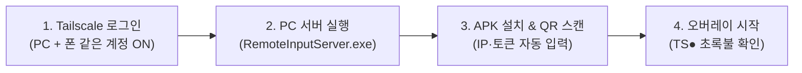

🇰🇷 <b>한국어</b> | <a href="README_EN.md">🇺🇸 English</a>

# Remote Input Overlay

Android 스마트폰에서 원격 화면(Parsec · Moonlight 등) 위에 투명 터치 컨트롤러를 띄워, **Windows PC로 키보드·마우스 입력을 전달**하는 무료 도구입니다.  
**PC 프로그램 없이 블루투스로 30초 연결**하거나, **Tailscale로 밖(5G/LTE)에서도 원격 제어 + 한글 퀵채팅**을 사용할 수 있습니다.

---

## 🎬 실제 동작 미리보기

> [▶ 전체 고화질 시연 영상 보기 (4분 28초 · MP4)](https://github.com/rech4210/remote-input-overlay/releases/download/v1.4.3/demo.mp4)

---

## ⚡ 2가지 연결 모드 선택

| 모드 | 추천 환경 | PC 설치 | 특징 |
|:---:|:---|:---:|:---|
| **🔵 블루투스 모드** *(추천)* | 집 · PC 근처 (Android 9+) | **무설치 (0개)** | 폰이 실제 **블루투스 키보드·마우스**로 동작 · 방화벽/관리자 권한 불필요 |
| **🌐 Tailscale 모드** | 외부 5G/LTE · 원거리 | `RemoteInputServer.exe` | **한/영 무관 한글 퀵채팅** · QR 코드 1초 연결 · WireGuard 암호화 |

<table>
  <tr>
    <td align="center" width="180">
       
      <b>📱 폰 카메라로 APK 받기</b>
    </td>
    <td>
      <b>원클릭 빠른 다운로드</b>  
       
       
      
    </td>
  </tr>
</table>

---

## 🔵 방법 A · 블루투스 무설치 모드 (30초 컷)

> [!TIP]
> PC에 아무 프로그램도 설치하고 싶지 않거나, 백신/방화벽 설정이 번거로울 때 가장 빠른 방법입니다. *(Android 9 이상)*

1. 스마트폰에 **APK 설치** → 상단 탭에서 **`🔵 블루투스 (무설치)`** 선택 → **`오버레이 권한 허용`**
2. **`📡 페어링 준비 (HID 키보드·마우스 켜기)`** 버튼 탭 → 허용
3. Windows **`설정 → Bluetooth 및 장치 → 장치 추가`** 에서 내 스마트폰 페어링 *(기존에 페어링돼 있었다면 한 번 제거 후 다시 페어링)*
4. 앱으로 돌아와 **`🔄 목록 새로고침`** → 페어링된 PC(`💻`) 선택 → **`오버레이 시작`** (`BT●` 초록불 확인!)

---

## 🌐 방법 B · Tailscale 원격 모드 (외부 5G · 한글 퀵채팅)

<b>Tailscale 모드 상세 설치 체크리스트 (클릭해서 펼치기)</b>

| 기기 | 설치할 프로그램 | 다운로드 |
|:---:|:---|:---|
| **PC** *(Win 10/11 64비트)* | **Tailscale** | [PC용 Tailscale 설치](https://tailscale.com/download/windows) |
| **PC** *(Python 불필요)* | **RemoteInputServer.exe** | [EXE 바로 받기](https://github.com/rech4210/remote-input-overlay/releases/latest/download/RemoteInputServer.exe) |
| **스마트폰** *(Android 8.0+)* | **Tailscale** | [Google Play 스토어](https://play.google.com/store/apps/details?id=com.tailscale.ipn) |

- [ ] PC·스마트폰 모두 **Tailscale** 같은 계정 로그인 후 **ON** *(VPN 권한 허용)*
- [ ] **`RemoteInputServer.exe`** 실행 → 관리자 권한 **`예`** → 콘솔에 **QR 코드** 표시 확인 *(Tailscale 전용 방화벽 규칙 자동 등록)*
- [ ] 앱에서 **`📷 QR 코드로 1초 연결`** → PC 화면 스캔 → **`오버레이 시작`** (`TS●` 초록불 확인)

---

## 🎮 조작 및 주요 기능

| 아이콘 | 기능 |
|:---:|:---|
| **`🔓` / `🔒` + `JOY`** | 드래그해 위치 이동 *(가로/세로 각각 저장)* · 탭하여 잠금 전환 |
| **`✎`** | 배치 편집 모드 ON/OFF *(이동·이름·크기·고정·복제·이미지·타이머·2단계 키)* |
| **`⚙`** | 빠른 설정 *(프리셋, 추천 갤러리, 조이스틱/D-PAD, 터치패드, 스킬 가이더, 퀵 채팅)* |
| **`–` / `+`** | **💊 초소형 알약 접기 / 펼치기** *(접으면 `+ BT●` / `+ TS●`만 남아 시야 확보)* |
| **`BT●` / `TS●`** | 연결 상태 *(초록=연결 · 노랑=재접속 · 빨강=끊김 / 탭 시 즉시 재접속)* |

<b>주요 기능 자세히 보기 (클릭해서 펼치기)</b>

- **🔁 2단계 교대 키 (`✎ → 키 탭 → 2단계 교대 키`)**: 1번째 탭은 원래 키(예: 스킬/메뉴), 2번째 탭은 지정 키(`↵Enter` 발사 / `ESC` 닫기 / 임의 키)를 전송합니다. `Enter`/`ESC`는 6초 후 자동 초기화됩니다.
- **⏱ 스킬 쿨타임 · 버프 타이머 (최대 60분)**: 시계방향 파이 게이지 + 남은 시간 표시. 30초 이상 타이머는 종료 10초 전 **상단 초슬림 HUD 필 알림(100% 터치 통과)** + 노란 깜빡임 경고 + 완료 플래시·더블 햅틱으로 알려줍니다.
- **🎯 스킬 가이더 & 2D 바닥 발판 마킹 (`⚙ → 🎯 스킬 가이더`)**: 터치를 100% 통과시키는 2D 타일 사거리 격자(모양 3종 `십자+사각`/`전체격자`/`마름모`, 2중 사거리, 가로/세로 비율 분리, 바깥 테두리·내부 눈금자·채우기 색상 분리, **`9×9` 인터랙티브 2D 바닥 발판 마킹**).
- **🎨 2단계 UI 컬러 · 테마 & 사이드 도킹 (`⚙ → 🎨 테마 · 컬러`)**: 전역 테마 6종(`기본 다크`, `네온 사이버`, `에메랄드`, `앰버 골드`, `스텔스`, `글래스`) + 개별 버튼 8색 지정. 설정창은 좌/우 **사이드 도킹(`⇄`)** · 드래그 이동(`⠿`) · 슬라이더 조작 중 **자동 반투명화(Live Peek)** 지원.
- **👆 멀티터치 & 꾹 키 자동 복구**: 모든 오버레이 윈도우 `FLAG_SPLIT_TOUCH` 지원으로 이동 중 공격/스킬 동시 입력(레트로이드 포켓 등 안드로이드 핸드헬드 포함) 및 PC 물리 키 입력 후에도 꾹 키 자동 복구(`v1.4.3`).
- **🎯 스마트 타겟팅 스와이프**: `TAB`뿐 아니라 원하는 모든 스킬 키에 적용 가능! 누른 채 상/하/좌/우로 밀면 방향키 이동 → 손 떼면 `Enter` 발사.
- **✊잡기 드래그 & 태블릿 터치패드**: 드래그=마우스 이동, 1지 탭=좌클릭, 2지 탭=우클릭, **`✊잡기`** 버튼으로 좌클릭 드래그 고정(아이템 이동/창 끌기), **`정밀`** 미세 이동 지원.
- **📂 팔레트(폴더) & 🌿 연결키**: 버튼 하나에서 최대 8개 키를 방사형 메뉴로 빠르게 실행. **`⊞Win`** 및 `Win+` 단축키 지원.
- **💬 퀵 채팅 바 (`⚙ → 💬 퀵 채팅` 또는 `💬채팅` 키)**: 입력 시 오버레이가 자동 숨김되며, Tailscale 모드에서는 **Windows 한/영 상태와 무관하게 한글·영문을 즉시 전송**합니다.
- **🌐 다국어 지원**: 앱 메인 화면 하단에서 **자동 / 한국어 / English** 즉시 전환 지원.
- **☁️ 추천 프리셋 갤러리 & 공유 (`⚙ → 📋 프리셋`)**: 슬롯 1~5 빠른 전환, 실시간 추천 프리셋(전투/마을/PC 원격/WASD) 불러오기, 텍스트 복사/붙여넣기 공유.

<b>자주 묻는 질문 / 문제 해결 (클릭해서 펼치기)</b>

- **블루투스 페어링했는데 연결(`BT●`)이 안 돼요**: Windows는 최초 페어링 시점의 HID 정보만 캐시합니다. 앱에서 **`📡 페어링 준비`**를 먼저 누른 상태에서 Windows Bluetooth 설정의 기존 폰을 **장치 제거** 후 다시 추가해 주세요.
- **"지정한 장치, 경로 또는 파일에 액세스할 수 없습니다" 오류가 떠요**: Windows 보안(Defender) 또는 백신이 서명 없는 `.exe`를 막았을 때 발생합니다.
  1. `RemoteInputServer.exe` 우클릭 → **속성** → 하단 **「차단 해제」 체크 → 적용**
  2. **Windows 보안 → 바이러스 및 위협 방지 → 보호 기록**에서 **「장치에서 허용(복원)」** 선택
  3. 아예 EXE 없이 쓰고 싶다면 위 **🔵 블루투스 무설치 모드**를 권장합니다!
- **Windows에서 "PC 보호" 파란 창이 떠요**: 개인 배포 파일이라 최초 1회 표시됩니다. `추가 정보 → 실행`을 누르면 정상 실행됩니다.
- **초록불인데 PC 프로그램에 키가 안 먹혀요**: Tailscale 모드에서는 `RemoteInputServer.exe`를 **우클릭 → 관리자 권한으로 실행**해 주세요.
- **버튼 위치가 꼬였거나 초기화하고 싶어요**: `⚙ → 프리셋 → ⭐ 기본 추천 배치 불러오기`를 누르면 기기 해상도에 맞춰 초기화됩니다.

---

## 💬 피드백 · 프리셋 공유

- **💬 피드백 / 버그 제보 (비로그인 가능)**: https://forms.gle/gepva2zctACe9hUK8
- **📤 추천 프리셋 공유 신청 (Google 로그인 필요)**: https://forms.gle/TFwHwKtfB8uzeE1U8

---

## ⚠️ 유의 사항 및 면책 안내

> [!WARNING]
> 본 프로그램은 개인의 원격 입력 편의를 위해 제공되며, 사용에 따른 모든 책임은 사용자 본인에게 있습니다.

- **Tailscale 계정 보안 및 `.overlay_token` 파일 관리**는 사용자가 직접 주의하여 관리해야 합니다.
- 앱 개선을 위해 버전·해상도·연결 성공 여부·기능 사용 여부 같은 익명 통계만 수집하며(**키 입력·채팅·IP·토큰 미수집**), 메인 화면 하단 스위치에서 언제든 끌 수 있습니다.
- 대상 프로그램·게임의 운영 정책, 보안 모듈 또는 업데이트에 따라 일부 입력이 제한되거나 작동하지 않을 수 있으며, 이로 인해 발생하는 불이익이나 손해에 대해 개발자는 책임을 지지 않습니다.
