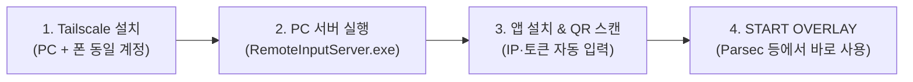

# Remote Input Overlay

Android 스마트폰에서 원격 화면(Parsec 등) 위에 투명 터치 컨트롤러를 띄워, **Tailscale 사설망**을 통해 Windows PC로 키보드·마우스 입력을 전달하는 프로그램입니다.

### 한눈에 보는 시작 순서 (약 3분)

---

## 1. 지원 환경 & 빠른 다운로드

| 항목 | 요구 사항 |
|:---|:---|
| **스마트폰** | Android 8.0 이상 |
| **PC** | Windows 10 / 11 (64비트) — Python 별도 설치 불필요 |
| **네트워크** | [Tailscale](https://tailscale.com/download) (PC·스마트폰 모두 무료 설치) |

- **📱 스마트폰용 APK 바로 받기**: [RemoteInputOverlay-v1.1.0.apk](https://github.com/rech4210/remote-input-overlay/releases/latest/download/RemoteInputOverlay-v1.1.0.apk)
- **💻 Windows PC용 EXE 바로 받기**: [RemoteInputServer.exe](https://github.com/rech4210/remote-input-overlay/releases/latest/download/RemoteInputServer.exe)
- **📦 통합 압축파일 / 전체 버전**: [Releases 페이지](https://github.com/rech4210/remote-input-overlay/releases/latest)

> [!NOTE]
> iOS(아이폰/아이패드)는 운영체제 정책상 다른 앱 위에 오버레이 창을 띄울 수 없어 지원하지 않습니다.

---

## 2. 처음 설치하고 연결하기 (3단계)

> [!IMPORTANT]
> PC와 스마트폰 모두 **Tailscale**을 설치하고 **같은 계정**으로 로그인해 연결 스위치(ON)를 켜 두어야 합니다.
> - PC: [tailscale.com/download](https://tailscale.com/download) · 스마트폰: Google Play 스토어에서 `Tailscale` 설치

### 1단계: Windows PC에서 서버 실행
1. 내려받은 **`RemoteInputServer.exe`** 를 더블클릭해 실행합니다.
   - Windows **"PC 보호"** 파란 창이 뜨면 **`추가 정보 → 실행`** 을 눌러주세요.
   - 방화벽 알림이 뜨면 **`사설 네트워크 허용`** 을 선택합니다.
2. 검은 콘솔 창이 열리며 **연결용 QR 코드**가 표시됩니다. *(같은 폴더에 이 PC만의 고유한 `.overlay_token` 파일이 자동 생성되므로 직접 만들 필요가 없습니다.)*

> [!TIP]
> 조작하려는 PC 프로그램이나 게임이 **관리자 권한**으로 실행 중이라면, `RemoteInputServer.exe`도 **우클릭 → 관리자 권한으로 실행**해야 입력이 정상 전달됩니다.

### 2단계: 스마트폰 앱 설치 및 권한 허용
1. 내려받은 **`RemoteInputOverlay-v1.1.0.apk`** 를 스마트폰에 설치합니다. *("출처를 알 수 없는 앱 허용" 팝업 시 허용)*
2. 앱을 실행하고 **`GRANT OVERLAY PERMISSION`** 을 눌러 **"다른 앱 위에 표시"** 권한을 켭니다.

### 3단계: QR 스캔으로 1초 연결 & 실행
1. 앱 상단의 **`📷 QR 코드로 1초 연결`** 버튼을 누르고 PC 콘솔 화면의 QR 코드를 비춥니다.
   - Tailscale IP · 포트(`8765`) · 토큰이 한 번에 자동 입력됩니다.
   - *(카메라 스캔이 어려우면 PC 콘솔의 `Tailscale IP`와 `.overlay_token` 파일 내용을 직접 붙여넣으셔도 됩니다.)*
2. **`START OVERLAY`** 버튼을 누릅니다.
3. 화면에 오버레이가 뜨고 상단 상태 점이 **초록색(`●`)** 이 되면 연결 완료입니다. 이제 **Parsec 등 원격 앱을 켜고 가로모드로 전환**하면 기기 해상도에 맞춰진 기본 배치로 바로 조작할 수 있습니다.

---

## 3. 조작 및 주요 기능

### 상단 제어 바 아이콘

| 아이콘 | 기능 |
|:---:|:---|
| **`🔓` / `🔒` + `JOY`** | 드래그해 위치 이동 *(가로/세로 위치 각각 자동 저장)* · 탭하여 잠금 전환 |
| **`✎`** | **배치 편집 모드** ON/OFF *(주황색 테두리 표시)* |
| **`📋`** | **빠른 프리셋 전환** (저장된 프리셋 1탭 즉시 전환) |
| **`⚙`** | 빠른 설정 메뉴 (조이스틱/D-PAD, 터치패드, 스마트 Tab, 프리셋 관리 등) |
| **`–` / `+`** | 오버레이 접기 / 펼치기 |
| **`●`** | 연결 상태 *(초록=연결됨 · 노랑=재접속 · 빨강=끊김 / 탭하면 즉시 재접속)* |

### 핵심 기능 요약
- **자유 버튼 편집 (`✎`)**: 드래그로 위치 이동(자석 스냅 지원), 버튼 탭으로 **이름 변경 · 크기(`S/M/L/XL`) · 1탭 누름 고정 · 연결키(Nested Key) · 아이콘 이미지** 설정
- **태블릿 터치패드**: 드래그로 마우스 이동, **1손가락 탭 = 제자리 좌클릭**, **2손가락 탭 = 우클릭**, 상단 **`정밀`** 버튼으로 미세 이동 전환 *(`⚙ → 태블릿 정밀도`에서 감도 조절)*
- **스마트 `Tab` 스와이프**: `TAB` 버튼을 누른 채 상/하/좌/우로 밀면 설정한 간격마다 1틱씩 탐색
- **프리셋 저장·공유 (`📋` / `⚙ → 프리셋`)**: 슬롯 1~5 저장, **슬롯별 이름 변경(`✎`)**, 텍스트 복사/붙여넣기 공유 및 **`⭐ 기본 추천 배치 불러오기`** 지원
- **자동 업데이트 · 로드맵**: 새 버전이나 공지가 등록되면 Android 앱과 PC 서버 모두에 자동 안내되며, 앱 하단 **`🗺 업데이트 계획`** 에서 예정 기능을 확인할 수 있습니다.

<b>자주 묻는 질문 / 문제 해결 (클릭해서 펼치기)</b>

- **Windows에서 "PC 보호" 파란 창이 떠요**: 개인 배포 프로그램이라 최초 1회 표시됩니다. `추가 정보 → 실행`을 누르면 정상 실행됩니다.
- **상태 점이 계속 노랑/빨강이에요**: PC와 스마트폰 모두 Tailscale이 **같은 계정으로 연결(ON)** 되어 있는지, PC에서 `RemoteInputServer.exe`가 켜져 있는지 확인해 주세요.
- **초록불인데 PC 프로그램에 키가 안 먹혀요**: 조작할 프로그램이 관리자 권한으로 실행 중일 수 있습니다. `RemoteInputServer.exe`를 **우클릭 → 관리자 권한으로 실행**해 주세요.
- **QR 코드가 잘 안 찍혀요**: PC 콘솔 창을 조금 키우거나, 콘솔에 적힌 `Tailscale IP`와 폴더 안 `.overlay_token` 파일 내용을 앱에 직접 입력하셔도 동일하게 연결됩니다.
- **버튼 위치가 꼬였거나 초기화하고 싶어요**: `⚙ → 프리셋 → ⭐ 기본 추천 배치 불러오기`를 누르면 기기 해상도에 맞춰 깔끔하게 초기화됩니다.

---

## 4. 피드백 · 버그 제보 · 프리셋 공유

사용 중 불편한 점, 버그 제보, 기능 아이디어 또는 추천하고 싶은 프리셋(`RIO_PRESET_V1:...`)이 있다면 **로그인 없이** 아래 링크로 남겨주세요!
- **💬 비로그인 피드백 / 버그 제보하기**: https://forms.gle/gepva2zctACe9hUK8

---

## 5. 유의 사항 및 면책 안내

> [!WARNING]
> 본 프로그램은 개인의 원격 입력 편의를 위해 제공되며, 사용에 따른 모든 책임은 사용자 본인에게 있습니다.

- 본 프로그램은 사용자의 Tailscale 사설망 내에서만 동작하도록 설계되었으나, **Tailscale 계정 보안 및 `.overlay_token` 파일 관리**는 사용자가 직접 주의하여 관리해야 합니다.
- 대상 프로그램·게임의 운영 정책, 보안 모듈 또는 업데이트에 따라 일부 입력이 제한되거나 작동하지 않을 수 있으며, 이로 인해 발생하는 불이익이나 손해에 대해 개발자는 책임을 지지 않습니다.
