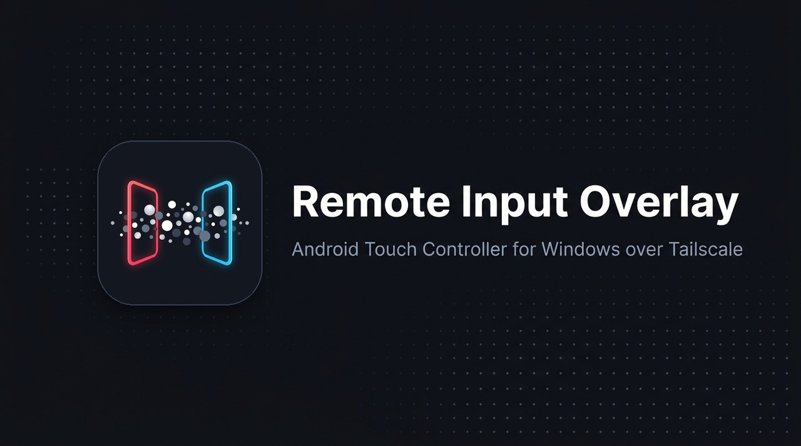
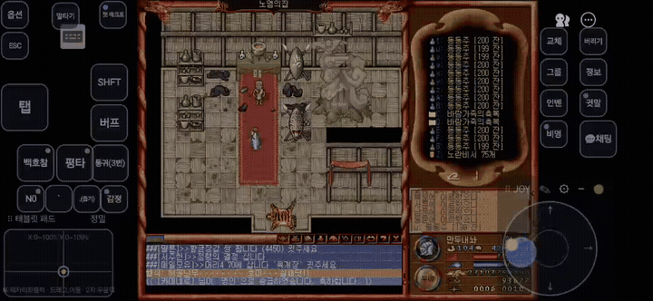
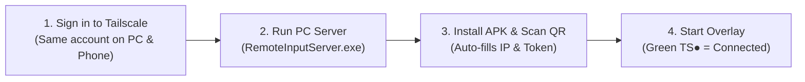

<a href="README.md">🇰🇷 한국어</a> | 🇺🇸 <b>English</b>

# Remote Input Overlay

A free, customizable **floating touch controller overlay for Android** that sends real keyboard & mouse inputs to your Windows PC — designed to sit cleanly on top of **Parsec, Moonlight, Sunshine, Steam Link, or Remote Desktop**.

Use **PC-less Bluetooth HID mode** with **zero PC software installed**, or **Tailscale mode** for encrypted remote control over 5G/LTE.

---

## 🎬 Demo Preview

> [▶ Watch Full HD Demo (4m 28s · MP4)](https://github.com/rech4210/remote-input-overlay/releases/download/v1.4.3/demo.mp4)

---

## ⚡ Two Connection Modes

| Mode | Best For | PC Software | Highlights |
|:---:|:---|:---:|:---|
| **🔵 Bluetooth HID** *(Recommended)* | Home / Nearby PC (Android 9+) | **None (0 installs)** | Phone acts as a native **Bluetooth Keyboard & Mouse** · No firewall or admin rights needed |
| **🌐 Tailscale Remote** | Away on 5G/LTE | `RemoteInputServer.exe` | **1-tap QR connect** · Unicode Quick Chat · WireGuard encrypted (`100.64.0.0/10` only) |

<table>
  <tr>
    <td align="center" width="180">
       
      <b>📱 Scan for Android APK</b>
    </td>
    <td>
      <b>Quick Download</b>  
       
       
      
    </td>
  </tr>
</table>

---

## 🔵 Option A · PC-less Bluetooth HID Mode (30-Second Setup)

> [!TIP]
> No Windows `.exe`, no Tailscale, no firewall rules, no antivirus warnings. Works with any Windows 10/11 PC with Bluetooth *(requires Android 9+)*.

1. Install the **Android APK** → tap **`🔵 Bluetooth (No PC App)`** → tap **`Grant Overlay Permission`**
2. Tap **`📡 Prepare Pairing (Enable HID Keyboard/Mouse)`**
3. On Windows, open **Settings → Bluetooth & devices → Add device** and pair your phone *(if already paired earlier, remove it once and re-pair while Prepare Pairing is active)*
4. Back in the app, tap **`🔄 Refresh List`** → select your PC (`💻`) → tap **`Start Overlay`** (green **`BT●`** = ready!)

---

## 🌐 Option B · Tailscale Remote Mode (Play Anywhere over 5G/LTE)

<b>Tailscale Mode Setup Checklist (Click to expand)</b>

| Device | App | Download |
|:---:|:---|:---|
| **Windows PC** *(10/11 64-bit)* | **Tailscale** | [Download Tailscale](https://tailscale.com/download/windows) |
| **Windows PC** *(No Python needed)* | **RemoteInputServer.exe** | [Download EXE](https://github.com/rech4210/remote-input-overlay/releases/latest/download/RemoteInputServer.exe) |
| **Android** *(8.0+)* | **Tailscale** | [Google Play](https://play.google.com/store/apps/details?id=com.tailscale.ipn) |

- [ ] Sign in to **Tailscale** with the same account on both PC and Android, and toggle **ON**.
- [ ] Run **`RemoteInputServer.exe`** as Administrator → a **QR code** appears in the console *(Tailscale-only firewall rule is auto-configured)*.
- [ ] In the Android app, tap **`📷 1-Tap QR Connect`** → scan the console QR → tap **`Start Overlay`** (`TS●` green dot).

---

## 🎮 Key Features

| Control | Function |
|:---:|:---|
| **`🔓` / `🔒` + `JOY`** | Drag to reposition *(saved separately for Portrait & Landscape)* · Tap to lock |
| **`✎`** | Edit Mode ON/OFF *(move, rename, resize, toggle-hold, clone, custom icon, timers, 2-stage keys)* |
| **`⚙`** | Quick Settings *(presets, online gallery, Joystick/D-PAD, trackpad, range grid, quick chat)* |
| **`–` / `+`** | **💊 Compact Pill Collapse** *(shrinks to a tiny `+ BT●` / `+ TS●` pill to clear your screen)* |
| **`BT●` / `TS●`** | Connection indicator *(Green=Connected · Yellow=Reconnecting · Red=Disconnected · Tap to reconnect)* |

<b>All Features in Detail (Click to expand)</b>

- **Precision Trackpad & `✊Grab` Drag Lock**: Smooth 1€-filtered mouse trackpad with 1-finger L-Click, 2-finger R-Click, **Fine Precision** mode, and **`✊Grab`** left-button drag lock for dragging windows or inventory items effortlessly.
- **🔁 2-Stage Alternate Keys**: Tap once to send Key A (e.g., skill/menu), tap again to send Key B (`↵Enter` confirm / `ESC` close / any custom key). Auto-resets after 6 seconds for `Enter`/`ESC`.
- **⏱ Cooldown & Buff Timers (up to 60 min)**: Clockwise radial pie overlay + `mm:ss` readout, pulsing amber warning in the final 10 seconds for timers ≥ 30s, plus ready flash & double-tap haptic.
- **🎯 Smart Targeting Swipe**: Enable on `TAB` or any custom key — press, drag in 4 directions to step cursor, release to confirm with `Enter`.
- **🎯 Click-Through Skill Range Grid**: 100% touch-passthrough tile grid with configurable tile pixel size, range (1–8 tiles), center offset, and opacity.
- **📂 Radial Palettes & Sub-Keys**: Pack up to 8 actions into one radial wheel button. Full `Ctrl`/`Shift`/`Alt`/`⊞Win` chord & key sequence support.
- **💬 Quick Chat Bar**: Temporarily hides the overlay while typing so your on-screen keyboard is never blocked.
- **☁️ Preset Slots & Live Gallery**: 5 quick slots, built-in online gallery (**PC Remote Essentials**, **WASD Action/MMO**, RPG presets), and clipboard share/import.
- **🌐 Built-in Language Switcher**: Switch between **Auto / 한국어 / English** right from the main screen.

<b>FAQ / Troubleshooting (Click to expand)</b>

- **Bluetooth paired, but `BT●` won't connect**: Windows caches HID services only during initial pairing. Tap **`📡 Prepare Pairing`** in the app first, then **Remove device** in Windows Bluetooth settings and pair again.
- **Windows SmartScreen / Defender warning on `RemoteInputServer.exe`**: Because it is an unsigned indie build, Windows may show a warning on first launch (`More info → Run anyway`, or right-click → Properties → Unblock). Or simply use **🔵 Bluetooth HID Mode** with zero PC software!
- **Keys don't register inside an elevated/admin game window (Tailscale mode)**: Run `RemoteInputServer.exe` as **Administrator**.

---

## 💬 Feedback & Preset Sharing

- **💬 Feedback / Bug Report (No login required)**: https://forms.gle/gepva2zctACe9hUK8
- **📤 Submit a Community Preset**: https://forms.gle/TFwHwKtfB8uzeE1U8

---

## ⚠️ Disclaimer & Privacy

> [!WARNING]
> This tool is provided for personal remote-input convenience. You are solely responsible for how you use it.

- **Privacy-first**: Anonymous usage stats (app version, screen size, connection success) can be disabled anytime via the toggle on the main screen. **Keystrokes, chat text, IPs, and tokens are never collected.**
- Some games or security modules may restrict virtual input; the developer is not responsible for any issues or restrictions imposed by third-party software.
